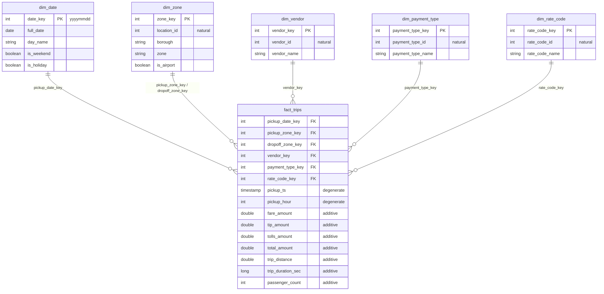

# CabStream - a PySpark lakehouse over NYC taxi trip records

**Author:** Nandini Goyal

A batch pipeline that takes 25 months of real NYC Taxi & Limousine Commission
trip data — **82,955,172 rows** — through a bronze → silver → gold lakehouse and
into a star schema, with schema-drift handling, measured data quality gates,
incremental loading, and a tuning study with real wall-clock numbers.

Every figure in this README came out of an actual run on this machine. None are
estimated, and the negative results are reported alongside the positive ones.

> **This runs in Spark local mode on a single machine** (Apple M-series, 10
> cores, 24 GB RAM). It is not deployed to a cluster and does not claim to be.
> The code is written so that it *could* be — no driver-side loops over trip
> data, no `collect()` on anything unbounded — but "runs on a cluster" is not
> something this project demonstrates, and the timings below are single-machine,
> warm-cache timings.

---

## The data

[NYC TLC Trip Record Data](https://www.nyc.gov/site/tlc/about/tlc-trip-record-data.page),
yellow taxi, **2023-01 through 2025-01** (25 monthly Parquet files), plus the
taxi zone lookup CSV.

Published by the New York City Taxi & Limousine Commission and free to use under
[their terms](https://www.nyc.gov/site/tlc/about/tlc-trip-record-data.page). TLC
publishes the data as-is; the trip records are collected by TLC-authorised
technology providers, not by TLC itself.

**This repository does not redistribute the data.** `data/` is gitignored. The
pipeline downloads the source files at runtime (1.3 GB) and skips any it already
has.

---

## Architecture

```
NYC TLC (CloudFront)
        │  idempotent download, .part-then-rename
        ▼
  data/raw/                    25 Parquet files + zone lookup CSV   (1.3 GB)
        │  explicit per-era schema → normalise to canonical
        ▼
  bronze/   82,955,172 rows    values untouched; names and types unified  (1.8 GB)
        │  8 cleaning rules, quality gate, reject vs flag
        ▼
  silver/   81,636,113 rows    validated trips, partitioned by pickup month (1.9 GB)
        │  conform to dimensions, assign surrogate keys
        ▼
  gold/     81,636,113 facts   star schema + 5 dimensions                 (1.9 GB)
```

Every layer is partitioned by year/month and each month is written
independently, so a month is the unit of processing, of idempotent overwrite,
and of the quality gate.

Storage paths all derive from one root, so moving the lakehouse to object
storage is a single environment variable — no code change:

```bash
export LAKE_ROOT=s3a://my-bucket/cabstream
```

---

## 1 — Ingestion, and the schema drift problem

TLC changed the physical schema of these files **twice** inside this window.
Handing Spark a directory of files whose schemas disagree either forces
`mergeSchema=true` — which reads every footer up front and *still* throws on the
type conflicts below — or resolves silently from whichever footer Spark samples
first.

Instead each file is read with the **explicit schema of its own era** and then
normalised to one canonical schema. All three published variants appear in the
loaded window:

| Variant | Months | What changed |
|---|---|---|
| `v1_legacy` | 2023-01 | baseline |
| `v2_narrowed` | 2023-02 → 2024-12 | `airport_fee` → **`Airport_fee`** (capitalisation only), plus five type changes: `VendorID` int64→int32, `PULocationID` int64→int32, `DOLocationID` int64→int32, `RatecodeID` double→int64, `passenger_count` double→int64 |
| `v3_cbd` | 2025-01 | adds `cbd_congestion_fee` (NYC congestion pricing) |

The capitalisation change is the dangerous one — it silently yields an all-null
column if you assume case-sensitive matching. Verified it did not:
`airport_fee` is non-null for **2,995,023** of `v1_legacy`'s rows and
**71,084,335** of `v2_narrowed`'s, both landing in the same canonical column.
And `cbd_congestion_fee` is non-null for all **3,327,673** rows of 2025-01 while
remaining a typed null across all 78.3M earlier rows — the column genuinely did
not exist yet, so a null means "did not exist", not "missing".

An unrecognised schema is reported and normalised, not fatal: a column TLC adds
next year appears in the drift log instead of breaking the run.

| | |
|---|---|
| Files | 25 |
| Rows | **82,955,172** |
| Source size | 1.3 GB |
| Bronze size | 1.8 GB (Snappy Parquet, 25 partitions) |
| Zone lookup | 265 rows |

---

## 2 — Cleaning and data quality gates

Eight rules, each a named function returning a predicate so it can be unit
tested. Measured across all 82,955,172 rows:

| | Rows | % |
|---|---:|---:|
| Read from bronze | 82,955,172 | 100% |
| **Rejected** | **1,319,059** | **1.590%** |
| Written to silver | 81,636,113 | 98.410% |
| Kept but flagged | 7,940,238 | 9.572% |

| Rule | Disposition | Rows caught | % of total |
|---|---|---:|---:|
| `zero_passengers` | flag | 6,949,752 | 8.3777% |
| `zero_distance` | flag | 1,640,655 | 1.9778% |
| `nonpositive_fare` | reject | 1,288,303 | 1.5530% |
| `dropoff_before_pickup` | reject | 31,130 | 0.0375% |
| `out_of_stated_month` | reject | 1,172 | 0.0014% |
| `duration_over_24h` | reject | 462 | 0.0006% |
| `null_key_field` | reject | 0 | 0.0000% |
| `unknown_zone` | reject | 0 | 0.0000% |

Rules overlap — one row can violate several — so the caught column sums to more
than 1,319,059. The report carries both numbers rather than implying they are
the same. A JSON report per run lands in `data/quality/run_<timestamp>.json`.

### Reject vs flag

Silently deleting 8% of rows is its own kind of data error, so every rule
declares a disposition:

- **reject** — the row cannot be modelled as a trip. `nonpositive_fare` is here
  deliberately: fare is an additive measure and TLC encodes voided trips as
  negatives, so leaving them in understates revenue in every `SUM`.
- **flag** — odd, but it genuinely happened. `zero_passengers` (8.4% of rows) is
  driver-entered and routinely left at 0; the *trip* is fine, only the headcount
  is unreliable. These reach silver with a boolean column, so "excluding
  zero-distance trips" is a `WHERE` clause rather than a re-run.

### Two rules caught nothing — and that was checked

`null_key_field` and `unknown_zone` scored zero. This is the data being clean,
not the rules being inert: bronze has 0 nulls across all four key fields, and
location IDs span exactly 1–265, matching the lookup. Both rules are proven
working by synthetic fixtures (`unknown_pu_zone=999`, `null_pickup_ts`) — which
is precisely why those fixtures exist.

### The gate stops the run

If more than N% of a month's rows are rejected (default 10%, configurable), the
pipeline raises and exits non-zero **before** writing. Demonstrated on 2024-12
with the threshold set to 2%:

```
QUALITY GATE FAILED - run aborted
  2024-12: 2.23% of 3,668,371 rows rejected, threshold is 2.00%.
  Nothing written to silver.
  Top reject rules: nonpositive_fare=80,497, dropoff_before_pickup=1,223, out_of_stated_month=34
```

The check runs per month, before that month's write, so one bad file cannot
poison a 25-month backfill. It also surfaced something real: 2025-01 rejects
**4.246%** of its rows, nearly triple the 1.59% average — congestion-pricing
month, with a corresponding jump in zero-fare records.

---

## 3 — The dimensional model



**Grain: one row per completed trip.**

| Table | Rows |
|---|---:|
| `fact_trips` | **81,636,113** (25 partitions) |
| `dim_date` | 1,462 |
| `dim_zone` | 266 |
| `dim_payment_type` | 8 |
| `dim_rate_code` | 8 |
| `dim_vendor` | 5 |

Referential integrity verified after the build: **0 orphan keys** across all six
foreign keys.

---

## 4 — Incremental loading

A JSON watermark records which `(layer, month)` partitions completed
successfully, written only *after* the Spark write returns — so a crash
mid-write leaves the month unmarked and it retries next run.

Measured, end to end:

| Run | Months requested | Processed | Wall clock |
|---|---|---|---:|
| Initial backfill | 24 | 24 | **332.9s** |
| Re-run, unchanged | 24 | 0 — all skipped | **6.5s** |
| Add one new month | 25 | 1 (`2025-01`) | **20.0s** |
| `--force` reprocess | 1 | 1 (`2025-01`) | **16.3s** |

Partition directories touched, by file mtime — the re-run and the incremental
run leave the existing 24 alone:

```
run 2 (no-op)          bronze added=0 rewritten=0 untouched=24
run 3 (new month)      bronze added=1 rewritten=0 untouched=24   + file_year=2025/file_month=1
                       silver added=1 rewritten=0 untouched=24   + pickup_year=2025/pickup_month=1
                       fact   added=1 rewritten=0 untouched=24   + pickup_year=2025/pickup_month=1
run 4 (--force)        fact   added=0 rewritten=1 untouched=24   ~ pickup_year=2025/pickup_month=1
```

**Idempotency**: row counts before and after the forced reprocess were byte-for-byte
identical — bronze 82,955,172 / silver 81,636,113 / fact 81,636,113, with
2025-01 holding 3,327,673 rows in both cases. The partition was *replaced*, not
appended to.

This rests on `spark.sql.sources.partitionOverwriteMode=dynamic`. In the default
`static` mode, `df.write.mode("overwrite")` on a partitioned table deletes **the
entire table** before writing — so loading one new month would destroy the other
24. Dynamic mode replaces only the partitions present in the DataFrame being
written.

**Late-arriving data** is handled by fingerprinting each source file with
SHA-256 and recording it in the watermark. If TLC republishes a month with
corrections, the fingerprint no longer matches, the month stops counting as
complete, and its partition is replaced whole. Without this, "already done"
would be indistinguishable from "done, but the vendor has since corrected it".

---

## 5 — Analytics and the tuning study

Eight SparkSQL queries in `src/analytics.py`, written as SQL against registered
views rather than DataFrame code: revenue by borough and month, busiest
pickup→dropoff pairs, tip percentage by payment type and hour, duration
percentiles ranked within borough (`RANK() OVER`), month-over-month growth
(`LAG` over an ordered window), airport analysis for JFK/LGA/EWR, weekday vs
weekend vs holiday demand, and vendor market share (`SUM(COUNT(*)) OVER`).

Ratios are always `SUM(a)/SUM(b)`, never `AVG(a/b)` — the two are different
numbers and the second is wrong, because it weights a $4 trip the same as a $400
one.

### Method

Each variant runs into Spark's `noop` sink (forces the full plan, writes
nothing), after one discarded warm-up, with `spark.catalog.clearCache()` between
variants. The table reports the **median of 5 timed runs**. Where two variants
must return the same answer to be a fair test, that is asserted rather than
assumed.

### Results

| Experiment | Variant | Median | Min | Change |
|---|---|---:|---:|---:|
| **Partition pruning** | predicate on `pickup_ts` (no pruning) | 0.813s | 0.780s | |
| | predicate on partition columns | **0.036s** | 0.033s | **22.6× faster** |
| **Broadcast join** | sort-merge (`autoBroadcastJoinThreshold=-1`) | 11.053s | 10.251s | |
| | broadcast (default 10 MB) | **0.819s** | 0.794s | **13.5× faster** |
| **Cache, `SELECT *`** | no cache, 3 scans | **0.418s** | 0.410s | |
| | `.cache()` on all 27 columns | 0.495s | 0.474s | **0.84× — slower** |
| **Cache, projected** | no cache, 3 scans of 3 columns | **0.403s** | 0.387s | |
| | `.cache()` on 3 columns | 0.465s | 0.449s | **0.87× — slower** |
| **Shuffle partitions** | `spark.sql.shuffle.partitions=200` | 1.759s | 1.656s | |
| | `=20` | **1.403s** | 1.385s | 1.25× faster |
| **Same, AQE disabled** | `=200`, `adaptive.enabled=false` | 1.736s | 1.711s | |
| | `=20`, `adaptive.enabled=false` | **1.369s** | 1.348s | 1.27× faster |

### What the Spark UI shows

Read from the same REST endpoint the UI renders from
(`/api/v1/applications/<id>/stages`):

| Experiment | Variant | Stages | Tasks | Input MB | Shuffle read | Shuffle write |
|---|---|---:|---:|---:|---:|---:|
| Partition pruning | no pruning | 2 | 22 | 634.3 | 0.0 | 0.0 |
| | pruned | 2 | 11 | **6.4** | 0.0 | 0.0 |
| Broadcast join | sort-merge | 6 | 47 | 241.4 | **1193.9** | **1193.9** |
| | broadcast | 4 | 24 | 241.4 | **0.0** | **0.0** |
| Cache `SELECT *` | no cache | 4 | 36 | **56.0** | 0.1 | 0.1 |
| | cached | 6 | 48 | **17534.7** | 0.1 | 0.1 |
| Cache projected | no cache | 4 | 36 | 56.0 | 0.1 | 0.1 |
| | cached | 6 | 48 | 442.9 | 0.1 | 0.1 |
| Shuffle partitions | 200, AQE on | 2 | 32 | 330.4 | 76.3 | 76.3 |
| | 20, AQE on | 2 | 37 | 330.4 | 74.2 | 74.2 |
| Same, AQE off | 200, AQE off | 2 | **221** | 330.4 | 76.3 | 76.3 |
| | 20, AQE off | 2 | **41** | 330.4 | 74.2 | 74.2 |

### Reading the results

**Partition pruning (22.6×)** is the largest win and the cheapest to get. Both
queries return the identical answer — 3,475,024 trips, asserted in the harness —
but the pruned one reads 6.4 MB instead of 634.3 MB, because the predicate is on
the partition columns and Spark skips whole directories. Filtering on
`YEAR(pickup_ts)` instead reads every partition and discards rows afterwards.
This is the single most important consequence of the partitioning choice.

**Broadcast join (13.5×)** shows why star schemas are shaped this way. The
shuffle numbers are the story: 1,193.9 MB of shuffle read and write, versus
**zero**. Shipping a 266-row dimension to every executor is free; shuffling an
81M-row fact table across the network to meet it is not.

**Caching lost, twice — and that is the useful result.** The naive `.cache()`
was 16% *slower*, and the Spark UI explains it exactly: 56 MB read without the
cache, 17,534.7 MB with it. Caching materialises every column of every row,
which destroys the column pruning that made the Parquet scan cheap. Projecting
first cut the cache footprint 40× (17,534.7 → 442.9 MB) but it was still slower
than not caching. The honest conclusion: caching pays when *recomputation* is
expensive — an upstream join or wide shuffle — not when the source is already
columnar Parquet and the query touches 3 columns of 27. Reaching for `.cache()`
by reflex is a pessimisation here.

**The 200-partition default barely matters, because AQE already fixes it.** With
Adaptive Query Execution on (the Spark 3.5 default), 200 requested partitions
became 32 actual tasks — AQE coalesced them automatically, leaving only a 1.25×
gain from tuning by hand. Turning AQE off shows what the default would have cost
in an older Spark: **221 tasks instead of 41**. Tuning `shuffle.partitions`
manually is largely legacy advice on a modern runtime, and the measurement says
so rather than repeating the folklore.

---

## Design decisions

### Explicit schemas rather than `inferSchema`

Two different problems, one answer.

For the **zone lookup CSV**, `inferSchema=true` costs an extra full pass purely
to guess types, and the guess is data-dependent — a column holding only digits
in one release infers as int, and as string in the next.

For the **trip Parquet**, the footer carries types, so there is no guessing —
but there is a worse failure: three schemas disagreeing on a column name and
five column types. This distinction matters more than the usual "inferSchema is
slow" line, because for Parquet that line is not the real reason.

### Partition columns: `pickup_year` / `pickup_month`

**What it makes fast.** Almost every question asked of taxi data is bounded by
time, and each partition is ~3.3M rows — a natural query unit. Measured above at
22.6×. It also makes each month independently rewritable, which is what the
entire incremental design rests on.

**What it makes slow.** Any query *not* filtered by date reads all 25
partitions. A zone-centric question ("everything from JFK, all time") gets no
pruning at all. Partitioning by zone would serve that better but would give up
monthly idempotent overwrite and produce 265 badly-skewed partitions, since
Manhattan zones dwarf Staten Island ones.

**Why not by day.** 760 partitions of ~107k rows each would trigger the
small-file problem, and the metadata cost of listing them starts to outweigh the
pruning gained.

Partitions are derived from `pickup_ts`, which is only safe because the
`out_of_stated_month` rule already rejected rows dated outside their file's
month — verified: **0** rows in silver where the pickup timestamp disagrees with
its partition.

### Surrogate keys rather than natural keys

The natural keys here are already small integers, so the usual argument (narrow
join keys) buys little. The reasons that actually apply:

1. **There is nowhere to put "unknown".** `rate_code_id` is NULL for
   **5,258,481 rows**, and TLC *also* uses the literal value 99 to mean
   "unknown" — so the natural key space holds both a null and a magic number,
   with 0 and 99 already taken by real members. A surrogate range gives every
   dimension a dedicated `-1` Unknown member, so those rows still join and are
   still counted instead of vanishing from an inner join. Measured, not
   hypothetical: **5,258,481** fact rows carry `rate_code_key = -1`; every other
   foreign key has zero.
2. **The source re-codes itself.** This project measured TLC renaming a column
   and changing five types inside 24 months. If they renumber rate codes the way
   they renamed `airport_fee`, the surrogate key absorbs it in an 8-row
   dimension instead of rewriting 81M fact rows.
3. **Room for slowly-changing history.** TLC revises zone and borough naming
   between lookup releases. The surrogate key is what would let `dim_zone` hold
   two versions of `LocationID` 264 without colliding fact rows. Dimensions are
   loaded Type 1 (full overwrite) today; the key design keeps Type 2 available
   without a migration.

`dim_date` is the deliberate exception — a smart `yyyymmdd` key. That is
standard for date dimensions: it sorts chronologically, makes a pruning
predicate readable, and is stable forever without a lookup.

Keys are assigned with `row_number()` over the natural key, which is
deterministic — the same input always yields the same keys, which matters
because dimensions are rebuilt every run while the fact table is not.
`monotonically_increasing_id()` would be wrong: it encodes the partition index,
so keys would shift with parallelism. There is a test asserting exactly that,
across 1, 3 and 7 input partitions.

### Why the quality gate fails the run instead of warning

A warning in a log nobody reads produces a gold table that is quietly wrong, and
a dimensional model is trusted precisely because nobody re-checks it by hand.
Stopping before the write leaves the last known-good partition in place; writing
bad data and emailing about it does not. The threshold is configurable because
the right value is a business decision, not a code one.

### What is deliberately *not* stored in the fact table

Tip percentage. It is a ratio, so summing or averaging it across groups is wrong
— the average of ratios is not the ratio of averages. It is computed in the
analytics layer from two additive columns instead.

---

## Running it

Requires Python 3.11 and a JDK (17 recommended). PySpark 3.5.3.

```bash
uv venv --python 3.11
uv sync --extra dev

# everything, incrementally - safe to re-run, skips completed months
python -m src.pipeline --start 2023-01 --end 2025-01

# or layer by layer
python -m src.ingest  --start 2023-01 --end 2024-12
python -m src.clean   --start 2023-01 --end 2024-12
python -m src.model

# analytics and the tuning study
python -m src.analytics
python -m src.tuning --reps 5

# tests
python -m pytest tests/ -q
```

Useful flags:

```bash
python -m src.pipeline --months 2025-01 --show-partitions  # prove what was touched
python -m src.pipeline --months 2025-01 --force            # reprocess a corrected month
python -m src.clean --threshold 0.02                       # tighter gate
python -m src.clean --no-write                             # measure only
python -m src.analytics --query airport_trips
```

Configuration is environment-driven — see `src/config.py`: `LAKE_ROOT`,
`RAW_ROOT`, `QUALITY_FAIL_THRESHOLD`, `SPARK_DRIVER_MEMORY`.

**Windows:** install a JDK 17 (e.g. Eclipse Temurin). If `JAVA_HOME` is not
set, `get_spark()` looks under `C:\Program Files\Eclipse Adoptium`,
`C:\Program Files\Microsoft` and `C:\Program Files\Java` for a `jdk-17*` or
`jdk-11*` folder. Spark's local mode on Windows may also need `winutils.exe`
with `HADOOP_HOME` pointing at it.

---

## Tests

**82 tests**, run in CI on every push
([`.github/workflows/tests.yml`](.github/workflows/tests.yml)). They never touch
the lake or the network — every test builds its own data from
`tests/fixtures.py` or a `tmp_path` — so CI does not download 1.3 GB.

Coverage:

- **every cleaning rule** against synthetic edge cases, one test per case so a
  failure names the rule that broke
- **surrogate key generation** — density, ordering, uniqueness, and determinism
  across 1, 3 and 7 input partitions
- **the calendar** — floating holidays (nth-weekday rules are the part that can
  silently drift by a week), weekend flags, leap years
- **watermark logic** — per-layer independence, disk round-trip, atomic save,
  and reprocessing when a source fingerprint changes
- **idempotency** — writing the same month twice, rewriting one partition while
  others stay intact, and a corrected month replacing rather than appending
- **month parsing** — malformed `YYYY-MM` input and reversed `--start`/`--end`
  ranges fail fast with a clear error instead of a 404 or an `IndexError`

The original 70 Spark-backed tests passed in 14.84s; `tests/test_config.py`
adds 12 pure-Python tests that run without a SparkSession.

---

## Repository layout

```
src/config.py       paths, Spark session, month arithmetic
src/schemas.py      explicit source schemas, drift detection, normalisation
src/ingest.py       download + bronze
src/clean.py        cleaning rules + bronze → silver
src/quality.py      quality gate, run report
src/model.py        dimensions, surrogate keys, fact build
src/incremental.py  watermark, source fingerprinting, partition diffing
src/pipeline.py     the incremental orchestrator
src/analytics.py    8 SparkSQL queries over the star schema
src/tuning.py       measured performance experiments
tests/fixtures.py   synthetic malformed rows — TEST FIXTURES ONLY
```

### A note on the synthetic rows

`tests/fixtures.py` contains deliberately malformed rows — a dropoff in 1970, a
LocationID TLC never issued, null timestamps. They exist **only** so the
cleaning rules can be unit tested against inputs that are rare or awkward to
isolate inside 83M real rows. They are never written to the lake and are not
project data. Everything reported above is real TLC data processed locally.

---

## Author

**Nandini Goyal**
